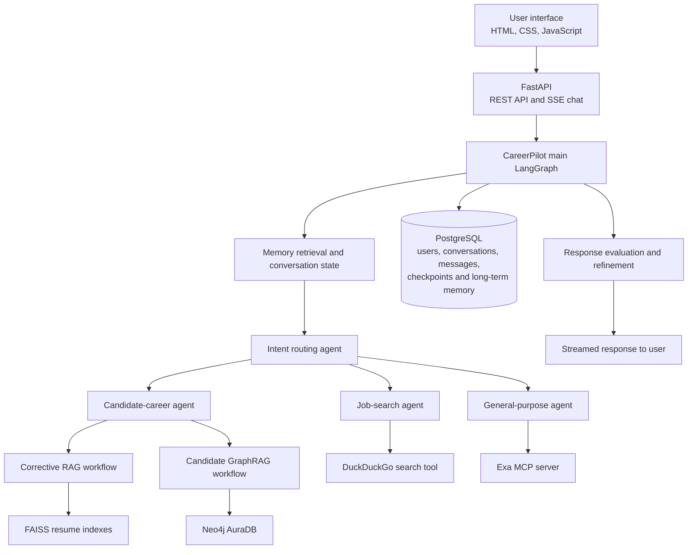

# CareerPilot — Agentic AI Career Assistant

CareerPilot is an AI-powered career assistant built around a multi-agent workflow. It combines conversational memory, resume-grounded retrieval, candidate knowledge graphs, job-search tools, and response evaluation in a web application.

Built with **LangGraph, LangChain, FastAPI, PostgreSQL, FAISS, Neo4j, Exa MCP, and LangSmith**.

---

## Core Workflows & Capabilities

CareerPilot uses a routing agent to classify user intent and direct requests to specialized workflows:

- **Candidate-Career Workflow:** Resume analysis, skill-gap and role-suitability analysis, and career/role recommendations grounded in resume evidence.
- **Job-Search Workflow:** Discovers current openings using a DuckDuckGo-backed search tool.
- **General Career Workflow:** Answers general career questions with external web research via an Exa MCP server.
- **Corrective RAG (CRAG):** FAISS-backed resume retrieval includes relevance evaluation and context/query refinement before answer generation.
- **Candidate GraphRAG:** Neo4j stores structured candidate entities and relationships extracted from resumes, queried alongside semantic resume evidence.
- **Memory & Persistence:** Short-term conversation state (`AsyncPostgresSaver`), cross-conversation long-term semantic memory (`AsyncPostgresStore` with `pgvector`), and user/conversation/resume records in PostgreSQL.
- **Authentication & Evaluation:** JWT access tokens with refresh sessions, LLM-based answer evaluation with refinement loops, and LangSmith execution tracing.

---

## Architecture



### Supported Intents

| Intent | Purpose | Primary Context / Tools |
|---|---|---|
| `job_search` | Find current job openings | DuckDuckGo search tool |
| `resume_analysis` | Analyze resume and experience | FAISS CRAG + Neo4j GraphRAG |
| `skill_gap` | Identify missing skills for a target role | FAISS CRAG + Neo4j GraphRAG |
| `job_recommendation` | Recommend suitable roles | FAISS CRAG + Neo4j GraphRAG + long-term memory |
| `general` | Answer general career questions | Exa MCP server + memory |

---

## Resume Ingestion & Retrieval

1. **Ingestion:** PDF resumes are parsed with PyMuPDF, split into chunks, embedded into FAISS indexes under `data/faiss/`, stored with metadata in PostgreSQL, and extracted into Neo4j entities (`Skill`, `Role`, `Company`, `Organization`, `Institution`, `Experience`, `Project`, `Research`, `Publication`, `Activity`, `Certification`) and relationships (`HAS_SKILL`, `HAS_EXPERIENCE`, `WORKED_AT`, `STUDIED_AT`, `WORKED_ON`, `CONDUCTED_RESEARCH`, `HAS_CERTIFICATION`).
2. **Corrective RAG:** Retrieved FAISS chunks are evaluated for relevance; ambiguous or insufficient evidence triggers query rewriting or context refinement.
3. **GraphRAG:** Structured candidate facts complement semantic chunks for candidate-specific questions (select a resume in the conversation before asking candidate-specific queries).

---

## Tech Stack

| Layer | Technologies |
|---|---|
| Backend & API | Python 3.11, FastAPI, Uvicorn, Pydantic |
| Agent & RAG | LangGraph, LangChain, FAISS, Neo4j, Custom CRAG |
| Search & MCP | DuckDuckGo Search, Exa MCP |
| Data & Memory | PostgreSQL, SQLAlchemy Async ORM, Alembic, pgvector, `AsyncPostgresSaver`, `AsyncPostgresStore` |
| Auth & Observability | JWT, `pwdlib` / Argon2, LangSmith |
| Frontend | HTML, CSS, vanilla JavaScript |

---

## Repository Structure

```text
.
├── frontend/
│   ├── index.html
│   ├── css/style.css
│   └── js/{api,auth,conversations,chat,app}.js
├── src/
│   ├── components/
│   │   ├── agents/
│   │   ├── auth/
│   │   ├── conversations/
│   │   ├── crag/
│   │   ├── database/
│   │   ├── evaluation/
│   │   ├── graph/
│   │   ├── graphrag/
│   │   ├── llm/
│   │   ├── mcp/
│   │   ├── memory/
│   │   ├── messages/
│   │   ├── resume/
│   │   └── retrieval/
│   ├── constants/
│   ├── routes/
│   └── utils/
├── alembic/
│   └── versions/
├── data/
│   └── faiss/
├── alembic.ini
├── main.py
├── pyproject.toml
└── requirements.txt
```

---

## API Endpoints

- **Auth:** `POST /auth/register`, `POST /auth/login`, `POST /auth/refresh`, `POST /auth/logout`
- **Conversations:** `POST /conversations`, `GET /conversations`, `DELETE /conversations/{conversation_id}`, `GET /conversations/{conversation_id}/messages`
- **Resumes:** `POST /resumes`, `GET /resumes`, `DELETE /resumes/{resume_id}`
- **Chat & App:** `GET /`, `GET /chat/conversations/{conversation_id}/resume`, `POST /chat/conversations/{conversation_id}/stream`, `GET /health`, plus `/docs` for interactive OpenAPI docs.

---

## Configuration

Configure environment variables in `.env` (see `src/constants/settings.py` for all options and defaults):

```env
DATABASE_URL=
OPENAI_API_KEY=

NEO4J_URI=
NEO4J_USERNAME=
NEO4J_PASSWORD=
NEO4J_DATABASE=neo4j

EXA_MCP_URL=https://mcp.exa.ai/mcp

LANGSMITH_TRACING=true
LANGSMITH_API_KEY=
LANGSMITH_PROJECT=careerpilot

JWT_SECRET_KEY=
REFRESH_COOKIE_NAME=careerpilot_refresh_token
REFRESH_COOKIE_SECURE=false
```

---

## Local Setup

1. Create a virtual environment and install dependencies from `requirements.txt` or `pyproject.toml`.
2. Populate `.env` with your PostgreSQL, OpenAI, Neo4j, Exa MCP, LangSmith, and JWT settings.
3. Run database migrations:

```bash
python -m alembic upgrade head
```

4. Start the server:

```bash
uvicorn main:app --reload
```

---

## Security & Privacy Notes

- Keep `.env`, credentials, tokens, uploaded resumes, and local `data/faiss/` indexes out of version control.
- Use a strong `JWT_SECRET_KEY` and review external LLM, search, and MCP data-handling terms before uploading personal resumes.